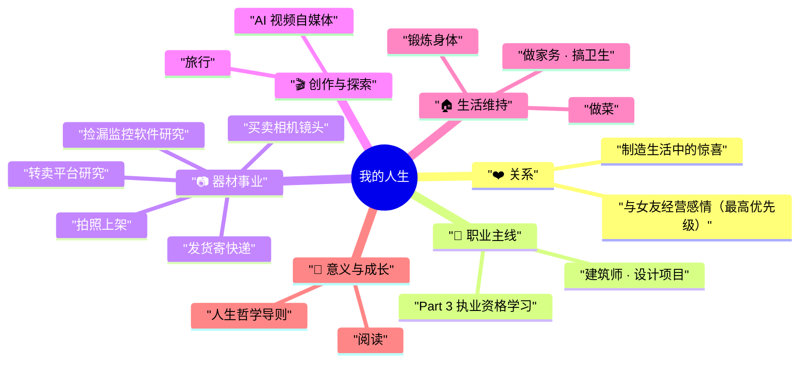
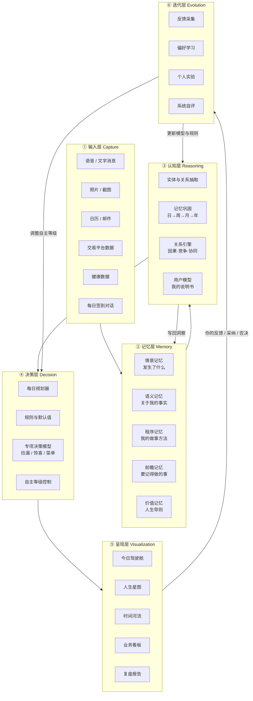
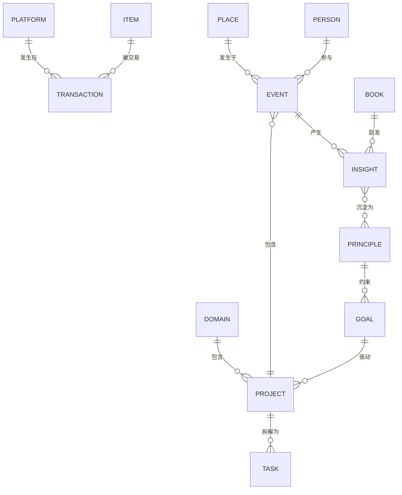
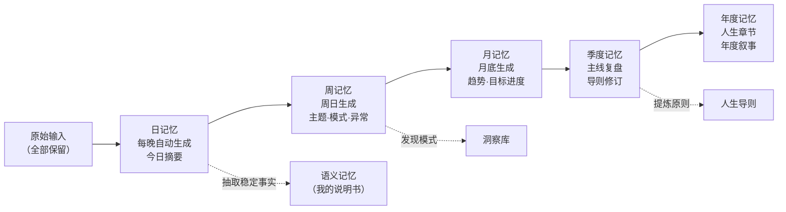
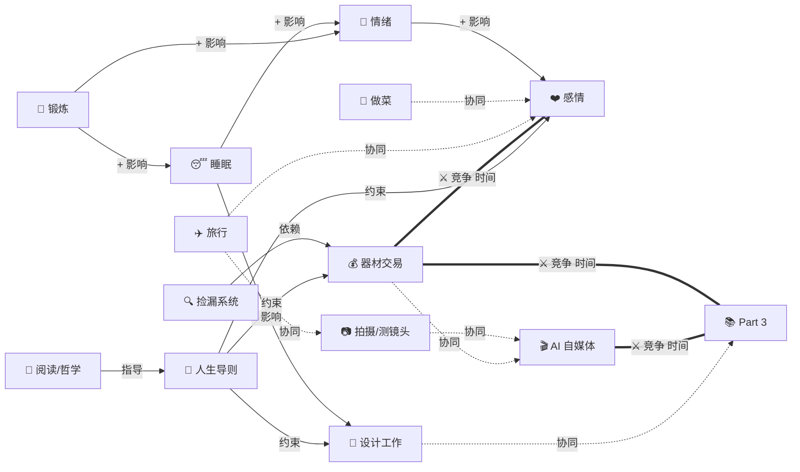
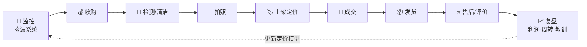
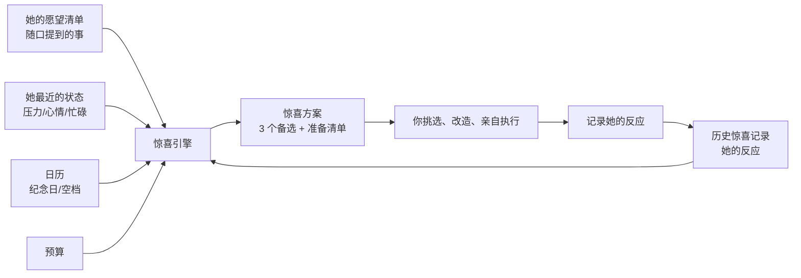
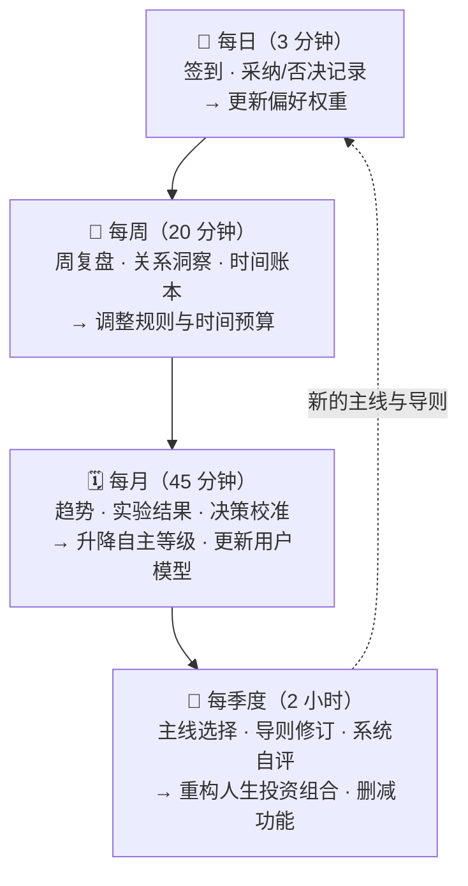
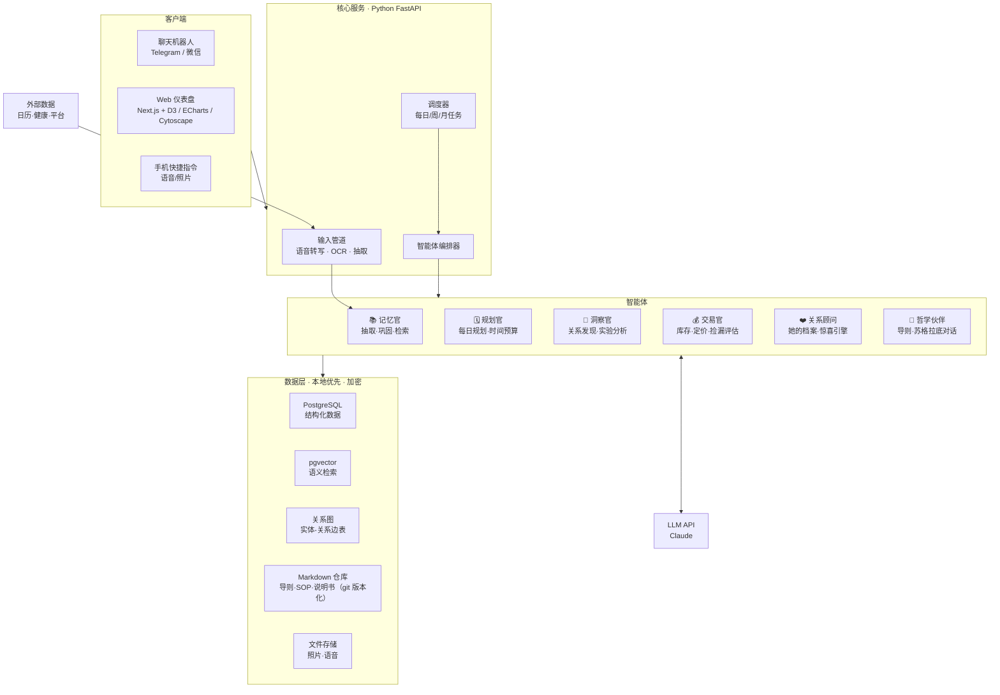
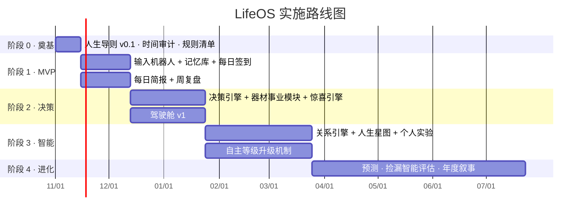

# LifeOS：基于 AI 的多维人生管理系统 · 完整方案 v1.0

> 一个以**记忆**为根基、以**关系网络**为骨架、以**决策减负**为目标、能**持续自我迭代**的个人人生操作系统。
>
> 作者：Zhipeng Han ｜ 版本：v1.1 ｜ 日期：2026-10-30 ｜ 实现：v0.1 已可用，见 [README](../README.md)

---

## 目录

- [0. 一句话定义与核心目标](#0-一句话定义与核心目标)
- [1. 现状诊断：你的人生地图](#1-现状诊断你的人生地图)
- [2. 设计哲学：十条原则](#2-设计哲学十条原则)
- [3. 系统总体架构](#3-系统总体架构)
- [4. 输入层：让记录几乎零摩擦](#4-输入层让记录几乎零摩擦)
- [5. 记忆系统：人生的第二大脑（核心）](#5-记忆系统人生的第二大脑核心)
- [6. 关系引擎：理解人生各部分之间的联系](#6-关系引擎理解人生各部分之间的联系)
- [7. 决策引擎：替你做掉简单的决定](#7-决策引擎替你做掉简单的决定)
- [8. 领域模块：每一条人生线的具体设计](#8-领域模块每一条人生线的具体设计)
- [9. 可视化系统：直观地查阅人生](#9-可视化系统直观地查阅人生)
- [10. 自我迭代机制：越用越懂你](#10-自我迭代机制越用越懂你)
- [11. 科学方法论底座](#11-科学方法论底座)
- [12. 技术实现方案](#12-技术实现方案)
- [13. 隐私、安全与伦理](#13-隐私安全与伦理)
- [14. 实施路线图](#14-实施路线图)
- [15. 场景演示：系统运转起来的一天与一周](#15-场景演示系统运转起来的一天与一周)
- [16. 风险与反模式](#16-风险与反模式)
- [17. 从今天开始的 7 件事](#17-从今天开始的-7-件事)
- [附录](#附录)

---

## 0. 一句话定义与核心目标

**LifeOS 是一个"会记住、会联系、会决策、会成长"的个人 AI 系统。**

它要解决的四个根本问题：

| # | 问题 | 现在的状态 | LifeOS 要达到的状态 |
|---|------|-----------|-------------------|
| 1 | **记忆碎片化** | 信息散落在微信、相册、备忘录、脑子里，过去的经验无法复用 | 所有输入沉淀为结构化的"人生记忆"，可检索、可回溯、可被 AI 理解 |
| 2 | **关系不可见** | 各条人生线各自运转，看不到它们之间的冲突与协同 | 系统自动发现"事与事"之间的因果、竞争、协同关系，并可视化 |
| 3 | **决策疲劳** | 每天大量微小决策消耗脑力（吃什么、先做什么、这个镜头收不收） | 简单决策由系统给出默认答案或直接执行，人只做真正重要的选择 |
| 4 | **系统不成长** | 每次计划都从零开始，无法从过去学习 | 每次反馈都让系统更了解你，管理模式越来越科学、越来越个性化 |

**北极星指标（North Star）**：
> 在不降低（最好提高）幸福感、关系质量与收入的前提下，**每天需要你亲自做的决策数量持续下降**，**每周能用于"重要但不紧急之事"的高质量时间持续上升**。

---

## 1. 现状诊断：你的人生地图

### 1.1 把你的人生拆成"线"

你描述的事情可以归类为 **6 大领域、14 条线**：



### 1.2 按"性质"重新分类

不同性质的事情，管理方式完全不同。这是整个系统设计的第一把钥匙：

| 类型 | 包含的事 | 特点 | 管理策略 |
|------|---------|------|---------|
| **维持型**（Maintenance） | 家务、卫生、做菜、发货 | 必须做、重复、价值在于"不出问题" | **规则化 + 批处理 + 自动化**，最大程度减少思考 |
| **主线型**（Core Career） | 建筑设计工作、Part 3 | 长期、高价值、需要深度专注 | **保护深度工作时间块**，按里程碑推进 |
| **收入型**（Business） | 器材买卖、捡漏、上架、平台研究 | 有明确的投入产出比，可量化 | **当成小生意来经营**：库存、流水线、利润、周转率 |
| **探索型**（Exploration） | AI 自媒体、捡漏软件研究 | 不确定性高，可能有大回报 | **限时实验**：设定时间预算与验证节点，不让它无限蔓延 |
| **关系型**（Relationship） | 女友、惊喜 | 不可量化地重要，无法"补课" | **受保护时间 + 记忆驱动的用心**，系统提醒，但绝不机械化 |
| **意义型**（Meaning） | 阅读、人生哲学、旅行 | 决定"为什么"，是所有决策的最终依据 | **导则化**：沉淀成"人生导则"，成为决策引擎的价值函数 |

### 1.3 核心矛盾：一周只有 168 小时

先做一次诚实的时间预算（示例，需按你的实际情况校准）：

| 项目 | 每周小时（估） | 备注 |
|------|---------------|------|
| 睡眠 | 52–56 | 不可压缩，压缩会让其他一切变差 |
| 建筑工作（含通勤） | 45–50 | 固定 |
| 女友高质量相处 | ≥ 12 | **受保护**，不是"剩下的时间" |
| 家务 + 做菜 + 卫生 | 7–9 | 可通过批处理压缩到 6 |
| 锻炼 | 3–4 | 3 次 × 1 小时 |
| Part 3 学习 | 6–8 | 考试/提交前需加码 |
| 器材交易全流程 | 5–8 | 收、测、拍、上架、沟通、发货 |
| 捡漏系统研究 | 2–3 | 探索型，需限时 |
| AI 自媒体 | 3–5 | 探索型，需限时 |
| 阅读与思考 | 2–3 | |
| 吃饭、洗漱、杂事、缓冲 | 15–20 | 永远被低估 |
| **合计** | **≈ 152–178** | **⚠️ 已经超载或贴着上限** |

**诊断结论**：

1. **你不是时间管理有问题，而是"线"太多。** 系统的首要任务不是让你更高效地塞进更多事，而是帮你**每个季度明确主线与支线**，有意识地取舍。
2. **很多线其实可以合并成"协同簇"**，一份时间产出多份价值：
   - `旅行 × 拍照 × 测试镜头 × 自媒体素材 × 和女友的惊喜` → 一次出行，五重收益
   - `器材交易 × 捡漏系统 × 平台研究 × 自媒体（器材评测/捡漏故事）` → 一个"器材事业"
   - `建筑师 × 摄影 × 审美` → 个人品牌的独特性
   - `做菜 × 和女友相处` → 维持型任务转化为关系型时间
3. **决策疲劳主要来自"切换"而非"任务本身"。** 在 14 条线之间来回切换的认知成本，远高于每件事本身。批处理和固定节律是最大的杠杆。

---

## 2. 设计哲学：十条原则

这些原则是系统所有设计决策的依据，也写入系统自身，让 AI 在迭代时遵守：

1. **记忆优先（Memory First）**：没有记忆就没有理解，没有理解就没有好决策。一切从"记住"开始。
2. **输入零摩擦（< 10 秒）**：任何记录如果超过 10 秒，长期一定会放弃。语音、拍照、转发，一句话丢进去，结构化交给 AI。
3. **AI 提议，人决定，逐步放权**：决策权按"自主等级"逐级下放，只有经过验证的决策类型才会被自动化。
4. **关系高于效率**：系统可以优化家务，但绝不"优化"爱情。与女友相关的模块目标是"更用心"，而非"更省时"。
5. **可解释**：每个建议都要说明"为什么"，并能追溯到具体记忆。不接受黑箱。
6. **证据驱动**：所有"我觉得"都可以变成假设，所有假设都可以变成实验，所有实验都要回到数据。
7. **少即是多**：系统本身不应成为第 15 条需要维护的线。维护成本 > 收益的功能，坚决删掉。
8. **本地优先、隐私至上**：人生数据是最私密的资产，默认本地存储、加密，不上传公开仓库。
9. **渐进构建**：先手动跑通流程，再半自动，最后自动。先有用，再好看，最后聪明。
10. **价值观为最终裁决**：当效率与人生导则冲突时，导则胜出。系统是为"你想成为的人"服务的。

---

## 3. 系统总体架构

### 3.1 六层架构



### 3.2 一条信息的完整旅程

以一句语音为例："今天在闲鱼上 1800 收了一支 50/1.4，有轻微镜头雾，女朋友说下个月想去海边。"

1. **输入层**：语音 → 转文字 → 带时间戳、地点入库。
2. **抽取**：AI 识别出两件不相关的事，拆成两条记忆：
   - `交易事件`：物品=50mm f/1.4 镜头，成本=1800，渠道=闲鱼，瑕疵=轻微雾，状态=已收购
   - `关系线索`：人物=女友，愿望=去海边，时间=下个月，类型=旅行愿望
3. **记忆层**：
   - 交易事件 → 库存表新增一项，状态"待检测"；价格历史库新增一条收购价。
   - 关系线索 → 写入"她的愿望清单"，并生成一条前瞻记忆："下月前规划海边旅行"。
4. **认知层**：关系引擎发现"海边旅行"可以与"测试新镜头""拍自媒体素材"形成协同簇。
5. **决策层**：
   - 镜头：根据历史数据，有雾镜头清洁后平均可卖 2300–2500，扣除清洁费与平台费，预期利润 ~350，建议"送清洁后上架"（L2 级：默认执行，可否决）。
   - 旅行：在本周日的"关系规划时段"里，自动准备 3 个海边目的地备选（L1 级：仅建议）。
6. **呈现层**：今日驾驶舱出现两张卡片；人生星图上"女友"节点与"旅行"节点之间的连线变粗。
7. **迭代层**：你最终选了目的地 B 而非系统推荐的 A，系统记录原因（"她不喜欢人多"），更新"她的偏好"。

---

## 4. 输入层：让记录几乎零摩擦

### 4.1 输入通道

| 通道 | 用途 | 摩擦 | 优先级 |
|------|------|------|-------|
| **聊天机器人**（Telegram / 微信 / iMessage 快捷指令） | 随时一句话丢进去：文字、语音、图片 | 极低 | ⭐⭐⭐ MVP 必做 |
| **每日签到对话**（晚上 3 分钟） | AI 主动问 3–5 个问题，补全一天的记忆 | 低 | ⭐⭐⭐ MVP 必做 |
| **日历同步** | 工作会议、约会、截止日期 | 零（自动） | ⭐⭐⭐ |
| **相册/截图** | 器材照片、旅行照片、聊天截图中的信息 | 低 | ⭐⭐ |
| **交易平台记录** | 订单、价格、快递单号 | 中（初期手动/截图，后期半自动） | ⭐⭐ |
| **健康数据**（Apple Health / 手环） | 睡眠、步数、心率、运动 | 零（自动） | ⭐⭐ |
| **阅读笔记**（Kindle 高亮 / 微信读书） | 书摘、思考 | 低 | ⭐ |
| **记账/银行流水** | 收支 | 中 | ⭐ |

### 4.2 每日签到：最重要的输入仪式

每晚固定时间（如 22:00），系统发起一次 3 分钟对话。问题由 AI 根据当天的日程**动态生成**，但遵循固定骨架：

```
1. 【能量】今天整体能量 1-10？什么时候状态最好/最差？
2. 【事件】今天有什么值得记住的事？（系统会根据日历预先列出，你只需补充）
3. 【关系】今天和她有什么互动？她提到了什么？（她的心情、想要的、在意的）
4. 【决策反馈】今天系统给的 X 个建议，哪些好用，哪些不好？
5. 【明天】明天有什么一定要做的？（可选）
```

> 设计要点：问题要**具体**，而不是"今天过得怎么样"。具体的问题才能提取出有用的记忆。系统会逐渐学会对你问最有信息量的问题。

### 4.3 结构化抽取

所有原始输入保留原文（便于追溯），同时由 AI 抽取为结构化数据：

```json
{
  "raw_id": "raw_20261030_2147_001",
  "raw_text": "今天在闲鱼上 1800 收了一支 50/1.4，有轻微镜头雾……",
  "extracted": [
    {
      "type": "transaction",
      "domain": "器材事业",
      "entities": ["item:lens_50_1.4_#023", "platform:闲鱼"],
      "fields": { "action": "buy", "price": 1800, "defects": ["轻微雾"] },
      "confidence": 0.94
    },
    {
      "type": "relationship_signal",
      "domain": "关系",
      "entities": ["person:女友"],
      "fields": { "signal": "wish", "content": "想去海边", "when": "2026-11" },
      "confidence": 0.88
    }
  ]
}
```

**置信度低于阈值（如 0.7）的抽取会在签到时让你确认**，避免 AI "编造记忆"。

---

## 5. 记忆系统：人生的第二大脑（核心）

记忆系统是 LifeOS 的地基。设计参考了认知心理学对人类记忆的分类，因为人生管理需要的正是这几种不同的记忆。

### 5.1 五种记忆

| 记忆类型 | 回答的问题 | 例子 | 存储形式 |
|---------|-----------|------|---------|
| **情景记忆** Episodic | 发生过什么？ | "2026-10-12 和她去了 XX 餐厅，她很喜欢那道甜品" | 时间线事件 |
| **语义记忆** Semantic | 关于我/她/世界的事实是什么？ | "我上午 9–12 点设计效率最高""她对花粉过敏""某型号镜头二手均价 2400" | 知识图谱 + 属性 |
| **程序记忆** Procedural | 我是怎么做某事的？ | "镜头上架 SOP：清洁→12 张标准照→测焦→写描述→定价" | SOP 文档 / 清单 |
| **前瞻记忆** Prospective | 我未来要记得做什么？ | "11 月前规划海边旅行""纪念日 12/18""Part 3 案例提交截止" | 任务 + 触发条件 |
| **价值记忆** Normative | 我相信什么？我想成为什么样的人？ | "关系高于效率""不做让自己鄙视的生意" | 人生导则（版本化） |

另外，每条记忆都附带**情感标签**（心情、能量、满足感），这是理解"什么让你快乐/消耗"的关键数据。

### 5.2 实体模型：人生的"名词"

系统里所有记忆都挂在实体上，实体之间形成网络：



| 实体 | 示例 | 关键属性 |
|------|------|---------|
| **人物** Person | 女友、同事、客户、买家 | 偏好、重要日期、关系温度、互动历史 |
| **领域** Domain | 关系、职业、器材事业… | 当季权重、时间预算 |
| **目标** Goal | 通过 Part 3、器材月利润 X | 截止、衡量方式、所属导则 |
| **项目** Project | 某住宅设计项目、自媒体账号 | 阶段、里程碑、健康度 |
| **任务** Task | 拍 3 支镜头上架 | 时长、能量需求、可批处理标签 |
| **物品** Item | 某支镜头（含序列号） | 成本、状态、瑕疵、照片、售价 |
| **平台** Platform | 闲鱼、eBay、MPB、小红书… | 手续费、成交速度、客群特征 |
| **地点** Place | 城市、餐厅、拍摄点 | 去过的记忆、评价 |
| **书/观念** Book/Concept | 某本哲学书、某个概念 | 摘要、与你导则的关联 |
| **洞察** Insight | "周三晚上上架成交最快" | 证据、置信度、验证状态 |
| **导则** Principle | "不在疲惫时做大额收购决策" | 版本、来源、适用场景 |

### 5.3 记忆巩固：像睡眠一样整理记忆

人类在睡眠中把短期记忆巩固为长期记忆。LifeOS 也有一个"巩固"流程，否则记忆只会无限膨胀成垃圾堆：



**巩固时做的事：**

1. **压缩**：100 条日常琐事 → 一段周摘要。
2. **提升**：反复出现的事实升级为语义记忆。例："她第三次提到想学陶艺" → `女友.兴趣 += 陶艺（置信度高）`。
3. **关联**：建立跨领域连接。例："本周三次熬夜都发生在器材上架日" → 洞察候选。
4. **遗忘**：对低重要性、已过期的记忆降低检索权重（不删除，只是"沉底"）。
5. **冲突检测**：新信息与旧记忆矛盾时提醒你确认。例："你之前说不再收 XX 品牌镜头，但本周收了两支"。

### 5.4 记忆的重要性评分

每条记忆有一个动态重要性分数，决定它在检索和可视化中的显著程度：

```
重要性 = 情感强度 × 0.25
       + 涉及核心实体（女友/主线目标）× 0.25
       + 被引用/被检索次数 × 0.2
       + 与导则的相关度 × 0.15
       + 新颖度 × 0.15
       （随时间衰减，但被再次引用时会"复活"）
```

### 5.5 "她的档案"：一个特别的记忆空间

与女友相关的记忆单独设计，因为这是你明确说"很重要"的部分：

```yaml
person: 女友
basics:
  important_dates:
    - { name: 生日, date: "MM-DD", reminder: [-30d, -14d, -3d] }
    - { name: 在一起纪念日, date: "MM-DD", reminder: [-30d, -7d] }
  love_language: [待观察]   # 系统通过记录逐渐推断：服务行动 / 精心时刻 / 礼物 / 肯定言辞 / 身体接触
preferences:
  food: { likes: [], dislikes: [], allergies: [] }
  places: { likes: ["安静的地方"], dislikes: ["人多"] }
  style: []
wishlist:            # 她随口提过想要/想做的事 —— 惊喜引擎的燃料
  - { content: "想去海边", mentioned: 2026-10-30, status: 待规划 }
current_context:     # 她最近在经历什么
  - { content: "工作压力大", since: 2026-10-20 }
memories:            # 你们的重要共同记忆，可在纪念日生成回忆册
  - ...
conflict_notes:      # 发生过的分歧与和解方式（帮助你更好地理解她，而不是"记账"）
  - ...
```

> **核心洞见**：很多惊喜之所以难，不是因为没有创意，而是因为**她三周前随口提的那句话你忘了**。记忆系统让"用心"变得可持续。

---

## 6. 关系引擎：理解人生各部分之间的联系

这是你提出的"系统会思考记忆构建人生不同事情之间的关系系统"的具体实现。

### 6.1 四种关系类型

| 关系 | 含义 | 例子 | 系统如何使用 |
|------|------|------|-------------|
| **因果/影响** Influence | A 影响 B | 睡眠 < 6h → 次日设计效率下降；锻炼日 → 晚上心情更好 | 预测与提醒 |
| **竞争** Competition | A 和 B 争夺同一资源（时间/精力/钱/注意力） | 器材上架 vs 陪女友（周末晚上）；Part 3 vs 自媒体 | 冲突预警，帮助取舍 |
| **协同** Synergy | 做 A 同时推进 B | 旅行 + 拍摄 + 测镜头 + 自媒体素材 | 合并任务，一份时间多份收益 |
| **依赖** Dependency | B 需要 A 先完成 | 上架依赖拍照，拍照依赖清洁 | 排程与批处理 |

### 6.2 人生关系网络（初始假设版）

系统初始化时会带一张"假设网络"，然后用你的真实数据去验证、修正：



### 6.3 关系是如何被"发现"的

1. **共现分析**：哪些事件经常在同一天/同一周出现？（例：上架日与熬夜共现率 70%）
2. **时序相关**：A 发生后 1–3 天，B 的指标是否变化？（例：锻炼后次日专注时长 +18%）
3. **资源账本**：每周时间、精力、金钱分别流向哪里，哪些线在"抢"同一时段。
4. **语义关联**：LLM 读你的记忆，提出人类可读的假设（"你似乎在 Part 3 进度落后的周里更频繁地刷二手平台，可能是一种逃避行为？"）。
5. **你的确认**：每条关系都有状态：`假设 → 有证据 → 已验证 → 已否定`。

> ⚠️ **科学性约束**：相关不等于因果。系统必须标注"这是相关性观察"还是"这是经过实验验证的"。重要的因果假设会被转化为**个人实验**（见第 10 章）。

### 6.4 每周关系洞察报告（示例）

```
📊 本周关系洞察 · 2026 W44

🔴 冲突预警
  • 器材事业本周占用 11.5h（预算 7h），其中 4h 侵占了周六晚上的"关系时间"。
    → 建议：把拍照上架固定到周日上午批处理。

🟢 协同机会
  • 女友提到"想去海边"+ 你库存里有 2 支待测试的广角 + 自媒体缺少"旅行器材"选题。
    → 建议：11 月中旬一次海边周末，可同时完成 3 件事。

🔵 新发现（相关性，待验证）
  • 过去 6 周，锻炼次数 ≥ 3 的周，你的平均情绪 7.4；< 3 的周为 5.9。
    → 建议：作为实验，下两周强制 3 次锻炼，观察情绪变化。

⚪ 假设被否定
  • "周末上架成交更快"——数据显示工作日晚 20–22 点上架成交速度更快（中位 2.1 天 vs 3.4 天）。
```

---

## 7. 决策引擎：替你做掉简单的决定

### 7.1 决策分类：哪些可以交给系统

| 类别 | 例子 | 每天频次 | 可否交给系统 |
|------|------|---------|------------|
| **日程排序** | 今天先做什么、什么时候做 | 5–15 次 | ✅ 高度可交 |
| **生活琐事** | 吃什么、买什么菜、哪天打扫 | 5–10 次 | ✅ 完全可交 |
| **交易决策** | 这个镜头收不收、出价多少、定价多少、发到哪个平台 | 3–20 次 | ⚠️ 部分可交（小额可交，大额建议） |
| **批处理决策** | 什么时候集中拍照/发货 | 每周 2–3 次 | ✅ 规则化 |
| **关系决策** | 这周约会安排、惊喜创意 | 每周数次 | 💡 只提建议与提醒，决定权永远在你 |
| **人生决策** | 是否换工作、是否放弃某条线、季度主线 | 每季度数次 | 🧭 系统只做分析与镜子，绝不替你决定 |

### 7.2 自主等级（Autonomy Levels）：渐进式放权

这是决策引擎最核心的机制，借鉴自动驾驶分级：

| 等级 | 名称 | 系统行为 | 示例 |
|------|------|---------|------|
| **L0** | 仅记录 | 只记录你的决策，不干预 | 新决策类型的初始状态 |
| **L1** | 建议 | 给出建议与理由，你决定 | 镜头收购建议、惊喜创意 |
| **L2** | 默认 | 给出默认答案，你不反对就执行 | 今日日程、本周菜单 |
| **L3** | 自动 + 汇报 | 自动执行，事后告诉你 | 生成购物清单、安排发货时段、上架定价 |
| **L4** | 完全托管 | 自动执行，只在异常时打扰你 | 家务轮值、提醒体系 |

**升级规则**：某类决策连续 N 次（如 20 次）建议采纳率 ≥ 90%，系统**提议**升一级，你确认后生效。
**降级规则**：任何一次你说"这个决定错得离谱"，立即降一级并复盘原因。
**天花板规则**：关系类决策最高 L1，人生决策永远 L0–L1。

### 7.3 每日规划算法

**输入**：日历固定事项、任务池、你的能量曲线、当季主线权重、人生导则、天气、她的日程。

**步骤**：

```
1. 铺设"不可移动块"：工作时间、睡眠、已约定的约会
2. 铺设"受保护块"：关系时间、锻炼、深度学习（Part 3）
3. 按能量曲线匹配任务：
     高能量时段 → 深度任务（设计、Part 3、写脚本）
     中能量时段 → 沟通、交易谈判、拍照
     低能量时段 → 家务、打包发货、整理
4. 批处理合并同类任务（所有发货合一、所有上架合一）
5. 计算每个任务的优先分，填充剩余时间
6. 留出 20% 缓冲（人永远低估时间）
7. 生成"今天只需要记住的 3 件事"
```

**任务优先分公式（初始版，会被迭代学习调整）**：

```
优先分 = (重要性 × 主线权重 × 导则契合度)
       × 紧急度系数
       × 能量匹配度
       − 切换成本
       + 协同加分（一件事推进多条线）
```

- **主线权重**：每季度你选定的 1–2 条主线权重 ×1.5，支线 ×1.0，冻结线 ×0.3。
- **切换成本**：与上一个任务领域不同则扣分，鼓励成块工作。
- **协同加分**：一件事能推进多个目标，加分。

### 7.4 规则与默认值：消灭"不值得思考"的决策

很多决策根本不需要每次重新做。把它们一次性定成**默认规则**，以后不再思考：

| 领域 | 默认规则（示例，可调整） |
|------|----------------------|
| 🍳 **做菜** | 建立 12–15 道"拿手菜库"，系统按营养、季节、上次吃的时间自动生成周菜单 + 购物清单；周日采购 + 备菜 |
| 🧹 **家务** | 每日 15 分钟"复位"（碗、台面、垃圾）；每周六上午 1 小时大扫除，按区域轮换（A 周：厨房+卫生间，B 周：卧室+客厅） |
| 💪 **锻炼** | 周一/三/五 固定时段；系统只决定"今天练什么"（根据上次训练与恢复状态） |
| 📦 **发货** | 每周二、周六集中发货；当天 12:00 前成交的订单进当天批次 |
| 📷 **拍照上架** | 每周日上午 2 小时集中拍摄（固定灯光与背景）；工作日晚 20–22 点分批上架（数据验证后调整） |
| 💰 **交易** | 单笔 < X 元且符合模型的收购：L2 默认；> X 元：必须 L1 人工确认；疲惫/深夜不做大额决策 |
| ❤️ **关系** | 每周至少一次"无手机约会"；每周日 15 分钟"关系规划"（系统准备好素材） |
| 📚 **Part 3** | 工作日早上通勤/早起 45 分钟固定学习；周末一个 3 小时深度块 |
| 📖 **阅读** | 睡前 30 分钟，不看手机 |

> 这些规则本身就是"程序记忆"，系统会持续观察执行率与效果，并在复盘中提议修改。

### 7.5 专项决策模型

#### ① 捡漏收购决策模型

```
期望利润 = 预估售价 × 成交概率
         − 收购价
         − 平台手续费 − 运费 − 清洁/维修成本
         − 时间成本（预计处理小时数 × 你的时间单价）
         − 风险折价（瑕疵风险 × 损失额）

决策规则：
  期望利润 ≥ 收购价 × 15% 且 ≥ 绝对阈值（如 200 元） → 建议收
  资金周转：库存占用资金 > 上限 → 只收高周转品类
  品类黑名单：历史上亏损/难卖的型号 → 自动跳过
```

**数据来源**：你自己的历史成交记录（最可靠）+ 各平台成交价采样。
**风险因子库**：霉、雾、划痕、脱胶、对焦异常、卡口磨损……每一项都关联历史上的实际折价，越用越准。

#### ② 惊喜引擎（见 8.5 节详述）

#### ③ 季度主线选择

每季度末，系统基于以下信息帮你做"人生投资组合"再平衡（只做分析，决定在你）：

- 各条线过去一季的时间投入 / 产出 / 满足感
- 未来一季的已知事件（考试、项目交付、纪念日、旅行）
- 人生导则的优先级
- 输出：建议的"主线 / 支线 / 冻结线"组合及理由

### 7.6 决策日志：让每次决策都成为学习

所有中等以上的决策都记录：

```yaml
decision_id: D-2026-1030-03
question: 是否以 1800 收购 50/1.4（轻微雾）
options: [收, 不收, 还价到 1600]
system_suggestion: 还价到 1600，底线 1800
my_choice: 1800 直接收
reasoning: 卖家急出，怕被别人抢
prediction: 2 周内以 2400 售出
confidence: 70%
---
review_date: 2026-11-20
actual_outcome: 3 周后以 2250 售出，清洁花了 150
lesson: 雾镜预估售价应下调 8%；"怕被抢"情绪下的决策溢价约 200 元
```

> 定期回看"预测 vs 实际"，系统会计算你的**校准度**（你说 70% 把握的事，实际成功率是多少）。这是提升决策质量最科学的方法之一。

---

## 8. 领域模块：每一条人生线的具体设计

每个模块都遵循统一结构：**目标 → 记忆 → 自动决策 → 指标 → SOP**。

### 8.1 💼 建筑设计工作

- **目标**：高质量完成项目，保护深度工作时间，积累作品与经验（同时服务 Part 3）。
- **记忆**：项目档案（阶段、关键决策、甲方偏好、问题与解决方案）、设计灵感库、规范/做法笔记。
- **自动决策**：每日深度工作块的安排；会议前自动生成项目上下文摘要。
- **指标**：深度工作时长/周、项目里程碑按时率、加班小时数。
- **特别设计**：工作中遇到的合同、管理、法规问题 → 自动打标签"Part 3 素材"，进入学习系统。**工作即学习，一份时间两份收益。**

### 8.2 📚 Part 3 执业资格学习

> 已确认为英国 RIBA Part 3：按专业实践经验记录（PEDR）+ 案例研究 + 考试/面试的典型结构设计。

- **目标**：按时通过，且学习过程与日常工作互相强化。
- **记忆**：
  - 实践经验日志（专业经验记录，系统从工作记忆中自动预填草稿，你只需审核）
  - 知识卡片（合同、法规、执业管理、职业道德……）
  - 案例研究素材库（从真实项目中提取）
- **自动决策**：
  - **间隔重复**：每天推送到期复习的卡片（基于遗忘曲线算法，如 FSRS/SM-2）
  - 根据考试倒计时自动调整每周学习时间配额
- **指标**：卡片保持率、经验记录完成度、模拟题正确率、距离截止日的进度偏差。

### 8.3 📷 器材事业（交易 + 捡漏 + 上架 + 发货 + 平台研究）

**把它当成一个真正的小生意来经营。** 这是最适合数据化、自动化的一条线。

#### 8.3.1 库存流水线



每件物品是一个实体，有唯一编号，全生命周期可追溯：

| 字段 | 示例 |
|------|------|
| 编号 | L-2026-023 |
| 型号 / 序列号 | 50mm f/1.4 / #xxxxxx |
| 收购价 / 渠道 / 日期 | 1800 / 闲鱼 / 10-30 |
| 成色 / 瑕疵 | 9 成 / 轻微雾 |
| 处理成本 | 清洁 150 |
| 照片集 | 链接 |
| 上架平台 / 定价 / 日期 | … |
| 成交价 / 日期 / 买家 | … |
| 净利润 / 周转天数 / ROI | … |

#### 8.3.2 关键经营指标

- **月净利润**、**利润率**
- **平均周转天数**（资金效率的核心）
- **时薪**：净利润 ÷ 投入小时 —— **这个数字会告诉你这条线是否值得继续，以及值得投入多少时间**
- 各品类/型号的历史利润表（决定什么该收、什么别碰）
- 各平台对比：手续费、成交速度、成交价溢价、售后纠纷率

#### 8.3.3 SOP（程序记忆）

- **拍照 SOP**：固定背景、固定灯位、标准 12 张清单（正面、背面、卡口、前后镜片透光、序列号、瑕疵特写……），一次布景批量拍完。
- **上架 SOP**：AI 根据照片和检测记录**自动生成描述草稿**（型号、成色、瑕疵如实说明、配件清单），根据历史数据给出定价建议。
- **发货 SOP**：打包清单、保价规则、单号自动登记、发货后自动生成给买家的消息。

#### 8.3.4 捡漏监控系统研究

这本身是一个技术项目，也是器材事业的"雷达"。建议分阶段：

1. **阶段一：价格数据库**——先建立你关注型号的"合理价格区间"（来自你的成交记录 + 手动采样）。没有这个，任何监控都无法判断什么是"漏"。
2. **阶段二：关注与提醒**——优先使用平台自带的订阅/提醒/保存搜索功能及官方开放接口；在合规范围内对新上架信息做筛选。
3. **阶段三：智能评估**——对新信息自动套用 7.5 节的收购决策模型，只把"期望利润高"的推送给你，并附上评估理由。
4. **阶段四：反馈学习**——你点"收/不收/误报"，模型持续校准。

> ⚠️ 合规提醒：务必遵守各平台的用户协议与访问频率限制，避免违反平台规则导致封号或法律风险。能用官方能力实现的，优先用官方能力。

#### 8.3.5 平台研究

建立"平台档案"（语义记忆），持续积累：费率、规则变化、客群、哪些品类在哪个平台卖得好、季节性。系统在每次上架时推荐最优平台组合。

### 8.4 🎬 AI 自媒体（探索型）

- **定位建议**：不要从零找方向，而是**从你已有的独特性出发**——"建筑师 × 摄影器材 × 捡漏实战 × AI 工具"这个交叉点本身就很稀缺。
- **记忆**：选题库（系统自动从你的生活记忆中提取："今天捡漏的故事""这支镜头的建筑摄影实测"）、素材库（照片/视频按主题标签化）、发布记录与数据。
- **探索型管理**：
  - 设定**实验期**（如 8 周）和**时间预算**（如每周 4 小时）
  - 设定**验证节点**（如 8 周后看：完播率、涨粉、是否带动器材销售）
  - 到期复盘：加码 / 调整 / 冻结
- **协同**：每次旅行、每次拍摄、每次交易都自动沉淀为潜在素材，**让内容来自生活，而不是额外生产**。

### 8.5 ❤️ 感情经营（最高优先级模块）

**这个模块的设计原则与其他模块完全相反：其他模块追求省时省力，这个模块追求"更用心"。** AI 的角色是你的"记忆外挂"和"创意顾问"，而不是代替你去爱。

#### 8.5.1 受保护时间

- 每周关系时间是**第一个被排进日程的**，不是最后剩下的。
- 系统检测到其他事务侵占关系时间时，会**明确警告**（"本周关系时间只剩 5 小时，低于你设定的 12 小时底线"）。
- "在场"比"在一起"更重要：鼓励无手机时段。

#### 8.5.2 惊喜引擎

惊喜的本质 = **她说过的话 + 你记住了 + 在她没预料的时刻兑现**。



**三种尺度的节奏**：

| 尺度 | 频率 | 例子 | 准备时间 |
|------|------|------|---------|
| **微惊喜** | 每周 1–2 次 | 记得她提过的零食、下班接她、一张手写便签、做她喜欢的菜 | 5–30 分钟 |
| **中惊喜** | 每月 1 次 | 一次她想去但没提第二遍的餐厅、一次主题约会、一件她提过的小礼物 | 1–3 小时 |
| **大惊喜** | 每季度/纪念日 | 一次旅行、一本你们的照片书（你是摄影师，这是你独特的优势）、一个精心策划的纪念日 | 1–4 周 |

**她当下状态优先**：当她最近压力大，系统会倾向推荐"减轻她负担"类的惊喜（比如你承担某件她的琐事），而不是需要她投入精力的活动。

#### 8.5.3 关系温度

不是给感情打分（那会很奇怪），而是每周一个温和的自我觉察：

- 本周高质量相处时间
- 本周我是否真的倾听了？有没有忽略她提到的重要事情？
- 有没有未解决的小摩擦？
- 我最近一次主动表达感谢/爱意是什么时候？

#### 8.5.4 关系模块的伦理边界

- **不监视她**：系统只记录你自己的观察与记忆，不接入她的任何账号或数据。
- **尊重她的隐私**：她的个人信息存储在加密分区，绝不上传公开地方。
- **适当透明**：可以考虑在合适的时候告诉她你在用一个系统帮助自己"记住她说过的话"——很多人会觉得这很浪漫，而不是被冒犯。
- **AI 不替你说话**：系统可以提醒你、启发你，但情话、道歉、表白必须是你自己的语言。

### 8.6 🏠 生活维持（家务 · 做菜 · 卫生）

目标：**用最少的脑力维持高质量的生活基线**。

- **家务**：区域轮值表（L4 自动）、每日 15 分钟复位、季度深度清洁清单（换季衣物、冰箱、空调滤网……系统按季节自动提醒）。
- **做菜**：
  - 菜谱库（含时长、难度、食材、她是否喜欢、上次做的日期）
  - 周菜单自动生成（L2：默认菜单，你可以换）
  - 购物清单自动生成，按超市区域排序
  - 批量备菜 SOP（周日 1.5 小时 → 工作日每晚 20 分钟出餐）
  - **"一起做饭"标签**：把部分做菜时间标记为关系时间
- **物品与补货**：常用消耗品（洗衣液、纸巾、快递包材！）库存与补货提醒。

### 8.7 💪 健康与锻炼

- **数据**：睡眠时长与质量、静息心率、步数、训练记录、体重/体脂（可选）。
- **自动决策**：今天练什么（基于上次训练部位、恢复状态、睡眠质量）；睡眠不足时自动把高强度训练换成散步/拉伸。
- **关键关联**：系统会重点追踪"睡眠/运动 → 工作效率/情绪/关系质量"的关系，因为健康是所有其他线的地基。

### 8.8 ✈️ 旅行

- **愿望地图**：想去的地方（你的 + 她的），附带最佳季节、预算估计。
- **协同规划**：每次旅行自动检查可叠加的目标——测试哪些库存镜头、拍什么自媒体素材、是否叠加纪念日惊喜、是否有建筑参观（建筑师的旅行特权）。
- **旅行记忆**：照片 + 地点 + 情绪 + 故事，自动生成旅行记忆卡片，年底可汇编成照片书。

### 8.9 📖 阅读与人生哲学导则

这是整个系统的"操作系统内核"——**决定所有其他决策的价值函数**。

#### 8.9.1 人生导则（Life Principles）

一份版本化的文档，用 git 管理每一次修订（修订历史本身就是你思想成长的轨迹）：

```markdown
# 我的人生导则 v0.1

## 一、我想成为什么样的人
- ...

## 二、优先级（冲突时的裁决顺序）
1. 健康（身体与精神）
2. 与她的关系
3. 职业主线（建筑 + Part 3）
4. 财务自由的路径（器材事业等）
5. 探索与创作

## 三、决策原则
- 疲惫时不做重大决定
- 能用规则解决的事情，不用意志力解决
- 赚钱的方式不能让我鄙视自己
- 时间比钱更稀缺：一件事的时薪低于 X，考虑外包或放弃
- ...

## 四、关于关系
- 她说过的话值得被记住
- ...

## 五、我反复验证过的关于自己的事实
- 我早上状态最好
- ...
```

#### 8.9.2 阅读 → 思考 → 导则的管道

```
阅读高亮 → AI 提取核心观点 → 与你现有导则比对
    ├── 强化：已有导则得到新的支撑
    ├── 挑战：与现有导则冲突 → 生成一个"思考题"留给周末
    └── 新增：可能值得加入的新原则（候选区，30 天后再决定）
```

#### 8.9.3 苏格拉底式对话

每月一次，系统扮演"哲学伙伴"，基于你这个月的记忆提出深度问题，例如：

- "这个月你花在器材交易上的时间是陪伴她的 1.3 倍。这符合你写下的优先级吗？如果不符合，是导则需要修改，还是行为需要修改？"
- "你在书里划了一句'人是目的而非手段'。你觉得这句话和你做生意的方式有什么关系？"

> 系统不提供答案，只提供**镜子**。

---

## 9. 可视化系统：直观地查阅人生

作为建筑师，你对空间和视觉的敏感度是系统设计的优势。可视化不只是"图表"，而是**让你能"看见"自己的人生结构**。

### 9.1 视图总览

| 视图 | 回答的问题 | 形式 | 使用频率 |
|------|-----------|------|---------|
| **今日驾驶舱** | 今天我该做什么？ | 时间块 + 卡片 | 每天 |
| **人生星图** | 我的人生由什么组成，它们如何相连？ | 力导向知识图谱 | 每周 |
| **时间河流** | 我的人生是怎么流过来的？ | 可缩放时间线（日→年） | 随时查阅 |
| **人生平衡轮** | 各领域是否失衡？ | 雷达图（本周 vs 目标） | 每周 |
| **资源流向图** | 时间/精力/金钱流向哪里？ | 桑基图 | 每周/月 |
| **器材事业看板** | 生意怎么样？ | 看板 + 财务仪表 | 每天/周 |
| **关系时间线** | 我们一起经历了什么？ | 照片时间轴 + 愿望清单 | 每周/纪念日 |
| **人生热力图** | 我每天过得怎么样？ | 类似 GitHub 贡献图的年度情绪/能量热力图 | 每月/年 |
| **导则演化** | 我的思想如何变化？ | 版本对比 + 时间线 | 每季度 |

### 9.2 今日驾驶舱（示意）

```
┌──────────────────────────────────────────────────────────────────────┐
│  📅 2026-10-31 周六   ☀️ 14°C   ⚡ 预测能量：高（昨晚睡眠 7.6h）       │
├──────────────────────────────────────────────────────────────────────┤
│  🎯 今天只需记住的 3 件事                                              │
│   1. 09:00–12:00 Part 3 案例研究：合同管理章节（考试倒计时 47 天）       │
│   2. 14:00 发货批次：3 件（单号将自动登记）                             │
│   3. ❤️ 19:00 和她晚餐 —— 她上周提过想吃的那家日料（已帮你查到可订位）    │
├──────────────────────────────────────────────────────────────────────┤
│  🕐 时间块                                                             │
│  07:30 ████ 锻炼（下肢日）                                             │
│  09:00 ████████████ 📚 Part 3 深度学习                                 │
│  12:00 ██ 午餐                                                         │
│  13:00 ████ 🏠 周六大扫除（本周：厨房 + 卫生间）                         │
│  14:00 ██ 📦 发货批次                                                  │
│  15:00 ████████ 📷 拍照批次（4 支待拍）                                 │
│  17:00 ████ 缓冲 / 自由                                                │
│  19:00 ████████████ ❤️ 受保护：约会（手机静音）                          │
├──────────────────────────────────────────────────────────────────────┤
│  🤖 系统已替你决定（L2–L4）           │  💡 等你决定（L1）              │
│  ✓ 本周菜单与购物清单已生成            │  ? 捡漏提醒：某 35mm 定焦       │
│  ✓ 3 件库存已调价（-5%，滞销 > 21 天） │    期望利润 ¥420，置信度 72%   │
│  ✓ 下周二发货批次已排期                │    [收] [还价] [跳过]          │
├──────────────────────────────────────────────────────────────────────┤
│  ⚠️ 提醒：本周器材事业已用 8.5h / 预算 7h                               │
└──────────────────────────────────────────────────────────────────────┘
```

### 9.3 人生星图

- **节点**：人物、项目、物品、地点、书、洞察、导则。节点大小 = 重要性，颜色 = 领域。
- **连线**：粗细 = 关联强度；实线 = 已验证关系，虚线 = 假设关系；红色 = 竞争，绿色 = 协同。
- **交互**：点击"女友"节点 → 展开与她相关的所有记忆、愿望、共同经历；点击"某镜头型号" → 看到它的所有交易历史和利润。
- **时间滑块**：拖动查看人生网络在不同时期的形态——你会看到某些线在长大，某些线在萎缩。

### 9.4 设计语言建议

既然你是建筑师，建议把可视化当成一个**建筑项目**来设计：

- **人生作为一座建筑**：地基（健康、睡眠）、结构（职业主线）、空间（关系、生活）、立面（创作、自媒体）、天际线（人生哲学）。可以做一个"人生剖面图"视图。
- 统一的色彩系统：每个领域一个颜色，全系统一致。
- 信息密度克制：首页只展示最重要的信息，深层信息通过下钻获得。

---

## 10. 自我迭代机制：越用越懂你

**这是你说的"系统的重点"。** 迭代发生在四个层面：

### 10.1 迭代节奏



### 10.2 "我的说明书"（用户模型）

系统持续维护一份关于你的、可读的模型。这份文档就是系统"了解你"的具体体现，**你可以随时查看和纠正**：

```markdown
# 我的说明书（系统自动维护 · 最后更新 2026-W44）

## 能量节律
- 高效时段：08:30–11:30（置信度 高，基于 43 天数据）
- 低谷：14:00–15:30
- 睡眠 < 6.5h 时，次日深度工作时长平均下降 35%

## 决策特征
- 在"怕错过"情绪下倾向于高价收购（平均溢价 11%）
- 晚上 22 点后做的交易决策，后悔率是白天的 2.1 倍
- 对日程建议的采纳率 87%；对菜单建议的采纳率 62%（常换成更简单的菜）

## 动力来源
- 看到具体进度（如 Part 3 进度条）时执行率明显更高
- 被"必须"驱动时容易拖延，被"想要"驱动时投入更多

## 关系
- 她压力大的时期，"服务型"惊喜（替她分担）反馈最好
- ...

## 待验证的假设
- 锻炼是否提升次日情绪（实验进行中，第 2 周/共 4 周）
```

### 10.3 偏好学习

- **显式反馈**：👍 / 👎 / "改成…"，以及原因。
- **隐式反馈**：你实际做了什么（vs 系统建议什么）。系统记录每一次偏离，并尝试理解偏离的原因。
- **模式升级**：当某个偏离反复出现，系统主动提问："我注意到你总是把周三晚上的上架任务挪到周四，周三晚上是有什么固定安排吗？"然后更新规则。

### 10.4 个人实验（N-of-1 Experiments）

把"感觉"变成"知识"的科学方法：

```yaml
experiment: 锻炼对情绪的影响
hypothesis: 每周锻炼 ≥ 3 次，平均情绪评分提升 ≥ 1 分
design: A 期（2 周，≥3 次/周）/ B 期（2 周，按习惯）/ 重复一次 A-B
metrics: [每日情绪 1-10, 睡眠时长, 深度工作时长]
confounders: [工作压力, 天气, 是否与她见面]
status: 进行中 · 第 2 周
result: ~
decision: ~   # 实验结束后：采纳为规则 / 放弃 / 延长观察
```

可以做的实验示例：上架时间段对成交速度的影响、早起学习 vs 晚上学习的记忆保持率、无手机约会对关系满意度的影响、批处理家务 vs 每日少量的总耗时……

### 10.5 系统自评：防止系统本身成为负担

每季度系统要对自己做一次"体检"：

| 指标 | 含义 | 健康标准 |
|------|------|---------|
| 节省的决策数/天 | 系统替你做掉的决策 | 持续上升 |
| 建议采纳率 | 系统建议的质量 | > 75% |
| 记录负担 | 每天花在输入上的时间 | < 10 分钟 |
| 功能使用率 | 每个功能是否真的被用 | 季度未使用的功能 → 删除 |
| 记忆准确率 | 抽查的记忆是否正确 | > 95% |
| 主观价值 | "这个系统让我生活更好了吗？"1–10 | ≥ 7 |

---

## 11. 科学方法论底座

LifeOS 不是凭空设计的，它整合了一些有较好证据支持或经过广泛实践检验的方法（同时诚实标注其局限）：

| 方法 / 理论 | 在 LifeOS 中的应用 | 证据说明 |
|------------|-------------------|---------|
| **GTD（Getting Things Done）** 的"捕获"理念 | 输入层：一切先捕获到系统中，清空大脑 | 实践广泛，核心理念（外部化记忆以降低认知负荷）合理 |
| **执行意图**（Implementation Intentions，"如果…就…"） | 规则与默认值："周二 12 点后 → 发货批次" | 心理学中证据较扎实的行为改变技术之一 |
| **间隔重复 / 遗忘曲线** | Part 3 学习卡片 | 证据非常充分 |
| **深度工作 / 时间块** | 保护高能量时段给深度任务 | 实践广泛；任务切换有认知成本有实验支持 |
| **能量管理 / 时型（Chronotype）** | 根据个人能量曲线安排任务 | 个体差异显著，所以系统用你自己的数据而非通用规律 |
| **习惯形成**（提示-行为-奖励） | 固定节律、环境设计（如固定拍照布景） | 习惯形成时间因人因事差异很大，不要迷信"21 天" |
| **决策疲劳** | 减少琐碎决策的核心动机 | ⚠️ "意志力是有限资源"（自我损耗）的经典研究在重复实验中受到质疑；但**减少不必要的决策能节省时间和注意力**这一点无论如何都成立 |
| **校准训练**（预测 → 回顾） | 决策日志 | 来自预测研究，被证明能提升判断质量 |
| **N-of-1 实验** | 个人实验模块 | 医学研究中用于个体化干预，适合个人优化 |
| **Wheel of Life / 平衡轮** | 平衡轮视图 | 自我觉察工具，非严格科学测量 |
| **爱的语言** | 关系模块中观察她的偏好 | ⚠️ 流行但实证支持有限，只作为观察框架，不作为结论 |
| **PARA 信息组织法** | 记忆的目录结构（项目/领域/资源/归档） | 实践工具 |

> **"越来越科学"的真正含义**：不是套用更多理论，而是**用你自己的数据去检验哪些方法对你有效**。通用理论是起点，个人实验是终点。

---

## 12. 技术实现方案

### 12.1 两条路径

| 路径 | 适合 | 优点 | 缺点 |
|------|------|------|------|
| **A. 组装路线**（低代码） | 先跑起来、验证价值 | 1–2 周可用 | 记忆与决策能力有限，定制性差 |
| **B. 自建路线**（代码） | 长期、深度定制 | 完全贴合你、记忆与关系引擎可做深 | 需要开发投入 |

**建议：A 起步，B 演进。** 先用组装方案跑 4–6 周，积累数据并验证"哪些功能真的有用"，再把被验证的部分用代码实现。数据格式从第一天起就设计成可迁移的（Markdown + YAML + SQLite）。

#### 路径 A：组装方案（MVP）

- **记忆库**：Obsidian（本地 Markdown，天然支持双向链接和图谱视图）
- **输入**：Telegram Bot / iOS 快捷指令 → 调用 LLM API 抽取 → 写入 Obsidian 文件夹
- **AI**：Claude API（日常抽取用轻量快速的模型，周复盘/深度分析用最强模型）
- **日程**：Google Calendar / Apple 日历
- **器材库存**：一张结构化表格（SQLite 或 Airtable / 飞书多维表格）
- **复盘**：每周把本周记忆喂给 LLM，用固定提示词生成报告

#### 路径 B：自建方案（完整版）



**技术选型说明**：

| 组件 | 选型 | 理由 |
|------|------|------|
| 后端 | Python + FastAPI | AI 生态最好，开发快 |
| 数据库 | PostgreSQL + pgvector | 一个库同时搞定结构化数据、向量检索和图关系（边表），初期无需 Neo4j |
| 记忆检索 | 混合检索：向量相似度 + 时间 + 实体过滤 + 重要性加权 | 单纯向量检索会丢失时间和结构信息 |
| LLM | Claude API，使用工具调用（tool use）让模型读写记忆 | 长上下文适合周/月复盘；工具调用适合结构化抽取 |
| 调度 | APScheduler / cron | 每日签到、每周复盘、记忆巩固 |
| 前端 | Next.js + Tailwind；图谱用 Cytoscape.js；图表用 ECharts / D3 | 成熟、可视化能力强 |
| 输入 | Telegram Bot（API 友好）；语音转写用 Whisper 类模型 | 零摩擦 |
| 部署 | 家里的小主机 / NAS（本地优先），或私有云服务器 + 加密 | 隐私 |

### 12.2 智能体设计

每个智能体有自己的职责、可用工具和系统提示词。示例：

```yaml
agent: 记忆官 (Archivist)
role: 负责把原始输入转化为结构化记忆，维护记忆的准确与整洁
tools:
  - search_memory(query, time_range, entities, domain)
  - create_memory(type, content, entities, emotion, importance)
  - update_entity(entity_id, fields)
  - link_entities(a, b, relation, evidence)
  - ask_user_to_confirm(question)
rules:
  - 永远保留原文出处，记忆必须可追溯
  - 置信度 < 0.7 的抽取必须向用户确认
  - 不推断用户没有说过的关于他人的隐私信息
  - 发现与已有记忆冲突时，标记冲突而非覆盖
```

### 12.3 记忆检索的提示词骨架（示例）

```
你是 Zhipeng 的人生管理系统中的"规划官"。

【人生导则摘要】{principles_summary}
【我的说明书摘要】{user_model_summary}
【当季主线】{quarter_focus}
【今日日历】{calendar}
【任务池】{tasks}
【相关记忆】{retrieved_memories}
【昨日签到】{yesterday_checkin}

请生成明天的日程：
1. 先放不可移动块和受保护块（关系时间、锻炼、Part 3 深度块）
2. 按能量曲线匹配任务，合并同类批处理
3. 留出 20% 缓冲
4. 输出"明天只需记住的 3 件事"
5. 每个安排附一句理由，并引用相关记忆编号
6. 如果发现时间预算冲突，明确指出并给出取舍建议，不要偷偷压缩关系时间或睡眠
```

### 12.4 仓库目录结构（建议）

```
Life_syste/
├── README.md
├── docs/
│   ├── LifeOS-方案.md          ← 本文档
│   ├── architecture/            # 架构决策记录
│   └── prompts/                 # 各智能体提示词（版本化）
├── principles/
│   ├── 人生导则.md               # 版本化的人生哲学
│   └── 我的说明书.md             # 系统维护的用户模型（可脱敏后入库）
├── sops/                        # 程序记忆：各类 SOP
│   ├── 镜头上架.md
│   ├── 发货.md
│   └── 每周复盘.md
├── backend/                     # FastAPI 服务
│   ├── agents/
│   ├── memory/
│   ├── decision/
│   └── ingest/
├── frontend/                    # 可视化仪表盘
├── schemas/                     # 数据模型定义
└── data/                        # ⚠️ 个人数据，必须 .gitignore，绝不提交
```

---

## 13. 隐私、安全与伦理

人生数据可能是你拥有的最敏感的数据：财务、感情、健康、内心想法。

1. **数据与代码分离**：代码可以放在 git，**个人数据（`data/`）必须加入 `.gitignore`，永远不提交**。如果仓库是公开的，导则、说明书等文件也要考虑脱敏或放到私有仓库。
2. **本地优先**：数据库在本地或你控制的服务器上，磁盘加密。
3. **最小化发送给 LLM 的数据**：每次只检索与当前任务相关的记忆发送，不要整库上传；敏感字段（具体金额、地址、她的个人信息）可做脱敏处理。了解并选择不将数据用于训练的 API 设置。
4. **分级存储**：关系、健康、财务数据放在加密分区，访问需额外验证。
5. **备份**：3-2-1 原则（3 份副本、2 种介质、1 份异地），因为这是你人生的记忆。
6. **他人的隐私**：系统里会有女友、买家、同事的信息。只记录你需要的，尊重他们的边界；买家的地址电话等信息在交易完成后定期清理。
7. **AI 不是神谕**：系统的建议基于有限数据，可能出错，尤其在人生大事上，它只是一面镜子。

---

## 14. 实施路线图

**核心策略：先手动，再半自动，最后自动。每个阶段都必须让生活变得更好，否则停下来反思。**



### 阶段 0：奠基（第 1–2 周）· 不写代码

| 任务 | 产出 |
|------|------|
| 写下人生导则 v0.1（哪怕很粗糙） | `principles/人生导则.md` |
| 做一次真实的时间审计（记录 7 天时间去向） | 真实时间预算表 |
| 确定本季度（Q4 2026）的主线/支线/冻结线 | 一页纸 |
| 把第 7.4 节的规则清单改成你自己的版本，并开始执行 | 默认规则 v1 |
| 整理"她的档案"初版：重要日期、你已知的偏好和她提过的愿望 | 档案初版 |
| 建立器材库存表（把现有库存录入） | 库存表 |

**成功标准**：规则清单让你每天少想 5 件事。

### 阶段 1：MVP（第 3–6 周）

| 任务 | 产出 |
|------|------|
| 搭建输入机器人：一句话/语音/照片 → AI 抽取 → 存入记忆库 | 可用的捕获通道 |
| 每晚签到对话 | 每日记忆 |
| 每日简报：早上推送"今天的 3 件事 + 时间块" | 每日简报 |
| 周复盘：自动生成本周总结 + 时间账本 | 周报 |

**成功标准**：连续使用 4 周，输入负担 < 10 分钟/天，你觉得"它记得我忘了的事"。

### 阶段 2：决策（第 7–12 周）

| 任务 | 产出 |
|------|------|
| 每日规划器（L1→L2） | 自动日程 |
| 器材事业模块：流水线、利润、周转、上架描述生成、定价建议 | 生意看板 |
| 菜单 + 购物清单 + 家务轮值（L2→L3） | 生活自动驾驶 |
| 惊喜引擎 v1 | 每周惊喜建议 |
| 决策日志 | 校准数据 |
| 今日驾驶舱 Web 版 v1 | 可视化 |

**成功标准**：每天需要你亲自做的琐碎决策减少 50%；器材事业的"时薪"可以被准确计算。

### 阶段 3：智能（第 4–6 个月）

| 任务 | 产出 |
|------|------|
| 关系引擎：共现、时序相关、资源竞争分析 | 关系洞察周报 |
| 人生星图可视化 | 知识图谱视图 |
| 个人实验模块，跑完第一批 3 个实验 | 被验证的个人规律 |
| 自主等级自动升降机制 | 渐进放权 |
| 我的说明书 v1 | 用户模型 |
| 捡漏系统阶段一二：价格库 + 合规提醒 | 捡漏雷达 |

**成功标准**：系统提出至少 3 个你自己之前没意识到、但验证后确实成立的关于自己的规律。

### 阶段 4：进化（第 7–12 个月）

- 预测：下周的能量、哪些库存会滞销、哪些周关系时间可能被挤压
- 捡漏智能评估全流程
- 季度人生投资组合分析
- 年度人生叙事：自动生成 2027 年度回顾（照片 + 数据 + 故事 + 导则演化）
- 人生剖面图等高级可视化

---

## 15. 场景演示：系统运转起来的一天与一周

### 15.1 一个工作日

**07:00 · 早间简报**（Telegram 推送）
> 早上好。昨晚睡了 7.2 小时，今天预计能量中高。
> **今天的 3 件事**：① 上午完成 XX 项目立面深化（高能量块已保护）② 午休 20 分钟复习 Part 3 卡片（今日到期 18 张）③ 晚上 20:30 上架 2 支镜头（描述和定价已生成，你只需确认）
> 💡 她昨天说这周工作很累。今晚可以考虑你来做饭，系统推荐她喜欢的番茄牛腩（冰箱里有牛腩，缺番茄，已加入下班路上的购物清单）。

**12:40 · 捡漏提醒**
> 🔍 某 85mm 定焦，标价 ¥2100。参考你过去 6 次成交均价 ¥2650，估算期望利润 ¥310（扣除手续费与时间成本）。卖家描述"有使用痕迹"，建议先要镜片透光照。[收] [还价 1900] [跳过]

**20:30 · 上架确认**
> 2 支镜头的描述与定价已准备好（L3：如 30 分钟内无修改将自动按此上架）。

**22:00 · 晚间签到**（3 分钟）
> 系统：今天立面深化完成了吗？
> 我：完成了 80%，下午被会议打断了。
> 系统：记下了。这是本月第 4 次下午会议打断深度工作，要不要考虑跟团队沟通把会议集中在某个下午？
> 系统：晚饭她喜欢吗？
> 我：很开心，她说下周末想去看那个摄影展。
> 系统：已加入她的愿望清单，并在下周六下午预留了时间，需要我查一下展览的票务信息吗？

### 15.2 周日复盘（20 分钟）

```
📅 W44 周复盘

⏱ 时间账本
  设计工作 47h ✓ │ Part 3 6.5h ✓ │ 器材 8.5h ⚠️ 超预算 │ 关系 13h ✓
  锻炼 2 次 ⚠️（目标 3）│ 阅读 2h ✓

💰 器材事业：本周成交 3 件，净利润 ¥960，投入 8.5h，时薪 ¥113
   滞销预警：L-2026-017 已上架 26 天

❤️ 关系：惊喜 1 次（做饭）· 愿望清单 +1（摄影展）· 纪念日倒计时 49 天
   → 大惊喜筹备建议：3 个方向已生成，请在本周内选择

🔬 实验进展：锻炼-情绪实验 第 2/4 周

🧠 本周新学到的关于你的事：
   你在周三晚上的上架任务完成率只有 40%——周三是否不适合安排任务？

✅ 下周建议：
   1. 器材时间压回 7h：周三上架移到周四
   2. 锻炼改为早上（你早上执行率 85% vs 晚上 50%）
   3. 本周确定纪念日方向
```

---

## 16. 风险与反模式

| 风险 | 表现 | 对策 |
|------|------|------|
| **系统成为新的拖延方式** | 花大量时间调系统，而不是生活 | 开发系统本身也算入"探索型"时间预算；每个阶段有明确的停止条件 |
| **过度量化** | 什么都要打分，生活失去味道 | 关系、意义类只做觉察，不做 KPI；季度删除无用指标 |
| **关系机械化** | 惊喜变成"按计划执行任务"，她感觉到了 | AI 只提供记忆和灵感，执行与表达必须是你的；不按固定周期机械执行 |
| **AI 编造记忆** | 系统"记得"一件从未发生的事 | 所有记忆可追溯原文；低置信度必须确认；定期抽查 |
| **输入疲劳** | 两周后不想记录了 | 输入 < 10 秒；签到 < 3 分钟；尽量自动采集 |
| **数据泄露** | 私密信息被上传到公开仓库或第三方 | `.gitignore`、加密、最小化发送、私有仓库 |
| **被系统绑架** | 失去自主判断，"系统说了算" | 重大决策永远是 L0–L1；导则高于算法；每季度问自己"系统在为我服务吗" |
| **线太多的根本问题被技术掩盖** | 用系统去"硬塞"更多事情 | 系统首要职责是帮你**取舍**，而非帮你塞更多 |

---

## 17. 从今天开始的 7 件事

不需要等系统建好。以下事情今天就可以开始，而且它们都会成为系统未来的数据：

1. **写下人生导则 v0.1**：只写 5 条你最确定的原则和你的优先级排序。30 分钟。
2. **开始"一句话记录"**：建一个只有你自己的聊天群/备忘录，随时往里丢一句话。这就是未来记忆系统的原型。
3. **建立"她的愿望清单"**：把你能想起来的、她提过想要/想做的事情全部写下来。今晚就写。
4. **定 3 条默认规则**：比如"周二周六发货""周日上午拍照上架""周一三五锻炼"，从明天开始执行。
5. **建器材库存表**：每件物品的成本、状态、上架日。第一次计算你的器材事业"时薪"。
6. **做一周时间审计**：每天睡前花 2 分钟记录时间去向，一周后你会看到真相。
7. **选定本季度主线**：在 14 条线中，选出 Q4 剩下时间里最重要的 2 条，其他明确降级。

---

## 附录

### 附录 A：每日签到问题库

```
能量类：
- 今天能量 1–10？最好的时段是？
- 昨晚睡得怎么样？

事件类：
- 今天最值得记住的一件事？
- 有什么意外发生吗？
- 今天学到了什么？

关系类：
- 今天和她有什么互动？
- 她提到了什么（想要的、担心的、开心的）？
- 今天有没有表达感谢或爱意？

工作/业务类：
- 今天的深度工作完成了吗？被什么打断了？
- 今天有成交/收购/发货吗？

反思类（每周选用）：
- 今天哪个决定让你后悔？为什么？
- 今天你在哪件事上最像你想成为的那个人？
```

### 附录 B：周复盘模板

```markdown
# 周复盘 · {年}-W{周}

## 1. 数据（系统自动生成）
- 时间账本：
- 平衡轮：
- 器材事业：
- 健康：

## 2. 本周三个亮点

## 3. 本周一个遗憾，原因是？

## 4. 关系
- 本周和她的高光时刻：
- 她的近况与愿望更新：
- 下周的用心计划：

## 5. 系统反馈
- 哪个建议最有用：
- 哪个建议最离谱：
- 要新增/删除/修改的规则：

## 6. 下周三件最重要的事
```

### 附录 C：核心数据模型（简化）

```sql
-- 记忆（统一事件表）
CREATE TABLE memories (
  id            TEXT PRIMARY KEY,
  type          TEXT,          -- episodic / semantic / procedural / prospective / normative
  domain        TEXT,          -- 关系 / 职业 / 器材 / 生活 / 健康 / 创作 / 意义
  content       TEXT,
  raw_source_id TEXT,          -- 追溯原文
  occurred_at   TIMESTAMP,
  emotion       JSONB,         -- {mood: 7, energy: 6, tags: [...]}
  importance    REAL,
  confidence    REAL,
  embedding     VECTOR(1024),
  created_at    TIMESTAMP
);

-- 实体
CREATE TABLE entities (
  id         TEXT PRIMARY KEY,
  kind       TEXT,             -- person / project / item / place / platform / book / principle ...
  name       TEXT,
  attributes JSONB
);

-- 记忆-实体关联
CREATE TABLE memory_entities (
  memory_id TEXT REFERENCES memories(id),
  entity_id TEXT REFERENCES entities(id)
);

-- 关系边（关系引擎）
CREATE TABLE relations (
  id        TEXT PRIMARY KEY,
  source_id TEXT,
  target_id TEXT,
  kind      TEXT,              -- influence / competition / synergy / dependency
  strength  REAL,
  status    TEXT,              -- hypothesis / evidenced / validated / rejected
  evidence  JSONB
);

-- 决策日志
CREATE TABLE decisions (
  id                TEXT PRIMARY KEY,
  category          TEXT,
  question          TEXT,
  system_suggestion TEXT,
  my_choice         TEXT,
  autonomy_level    INT,
  prediction        TEXT,
  confidence        REAL,
  outcome           TEXT,
  lesson            TEXT,
  decided_at        TIMESTAMP,
  reviewed_at       TIMESTAMP
);

-- 器材库存
CREATE TABLE items (
  id            TEXT PRIMARY KEY,   -- L-2026-023
  model         TEXT,
  serial        TEXT,
  condition     TEXT,
  defects       JSONB,
  buy_price     NUMERIC,
  buy_platform  TEXT,
  bought_at     DATE,
  extra_costs   NUMERIC,
  status        TEXT,               -- 待检测 / 待拍照 / 在售 / 已售 / 已发货 / 完结
  list_price    NUMERIC,
  sell_price    NUMERIC,
  sell_platform TEXT,
  sold_at       DATE,
  hours_spent   REAL
);
```

### 附录 D：系统指标总表

| 层面 | 指标 |
|------|------|
| 系统价值 | 节省决策数/天、建议采纳率、主观价值评分、输入耗时 |
| 关系 | 高质量相处时间/周、惊喜次数/月、愿望清单兑现率 |
| 健康 | 睡眠时长、锻炼次数、情绪均值 |
| 职业 | 深度工作时长/周、Part 3 进度偏差、卡片保持率 |
| 器材事业 | 月净利润、周转天数、时薪、滞销率 |
| 创作 | 发布数、增长、来自生活的素材比例 |
| 意义 | 阅读时长、导则修订次数、每月深度思考次数 |

---

> **最后的话**
>
> 这个系统最终的目的，不是让你变成一台更高效的机器，而是把那些不值得你思考的事情交给机器，把你的注意力还给真正重要的东西——她、你的作品、你的身体、以及"我到底想过怎样的一生"这个问题。
>
> 系统会不断迭代，但它的第一个版本应该是：**今晚就写下她说过想要的三件事。**
