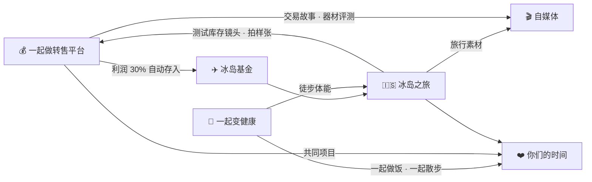

# ❤️ 她的三个愿望 · 行动计划

> 2026-10 她说：想去冰岛旅游；想和你一起开发相机设备转售平台；想减肥。
> 这三件事已经录入 LifeOS（`python -m lifeos her`），每件都挂了一个项目和起步任务。
> 最妙的是：**这三件事彼此连在一起，也和你已有的生活连在一起。**



**一句话**：一起卖镜头攒钱去冰岛，一起锻炼为了在冰岛徒步，一路拍下来做内容。

---

## 1. 🇮🇸 冰岛之旅

**第一步不是订机票，而是和她一起做一个决定：冬天还是夏天？**

| | 冬季（大约 9 月底–3 月） | 夏季（大约 6–8 月） |
|---|---|---|
| 主角 | 极光、冰洞、雪景 | 午夜阳光、高地、徒步、海鹦 |
| 自驾 | 白天短，路况复杂，需要更谨慎 | 环岛最舒服，部分高地路线通常只在夏季开放 |
| 拍摄 | 夜景、长曝光、三脚架 | 广角风光、长焦拍动物 |
| 价格 | 相对低一些 | 旺季，贵 |

（季节信息是通常情况，出发前请查当年的官方路况与天气信息。）

**起步任务（已在系统里）**
1. 和她一起决定季节 ← 放进约会时间聊，不要变成"任务"
2. 粗估预算，修改 `config/rules.toml` 里 `[funds."冰岛基金"] target`
3. 建一个共享灵感清单，发她第一张图
4. 确认两人护照与签证要求
5. 列拍摄器材清单——顺便测试库存里的广角镜头

**你独有的加分项**：你是建筑师。雷克雅未克的 Harpa 音乐厅、哈尔格林姆斯大教堂都是建筑爱好者必去的地方。你给她讲建筑，她给你当模特，这是别人复制不了的旅行。

**冰岛基金**：器材事业每赚一笔，30% 自动计入（比例可在 `rules.toml` 改）。仪表盘"器材"页有进度条。**让她看到这根进度条在涨**，这件事本身就是浪漫的。

---

## 2. 💰 一起开发相机设备转售平台

这是三个愿望里最需要小心的一个：**做得好，你们会多一个共同的事业；做得不好，生意上的分歧会渗进感情。**

### 三条原则
1. **工作时间和约会时间分开。** 每周固定 30 分钟"合伙人会议"（有议程、有记录），会后去吃饭，饭桌上不谈生意。
2. **分工清楚。** 先问她最想负责哪一块：拍照与修图？文案与店铺形象？客服？选品？你负责另外的部分。
3. **从小处开始。** 不要一上来就"开发平台"。先在现有平台上把流程一起跑通，用数据决定下一步。

### 分阶段路线

| 阶段 | 做什么 | 进入下一阶段的条件 |
|---|---|---|
| **P0 一起跑通流程**（现在） | 用 LifeOS 器材模块管库存；她参与几次完整的收→测→拍→上架→发货 | 她仍然觉得有意思 + 你们找到了舒服的分工 |
| **P1 共同橱窗** | LifeOS 已经有了 `/shop` 器材橱窗页（在售库存自动展示）——**这就是平台的第一个原型**，给她看，一起改 | 稳定每月有利润，时薪合理 |
| **P2 共同品牌** | 起一个店名，在已有平台（闲鱼/eBay/小红书/Instagram）统一形象；自媒体讲你们的器材故事 | 有回头客、有口碑 |
| **P3 自己的平台** | 只有当数据证明"自己的平台"比"现有平台"更好时才做（例如：寄卖模式、本地验货服务、有独特客群） | — |

**LifeOS 能帮的**：器材模块的库存、定价建议、上架文案草稿、利润与时薪统计、瑕疵折价自学习，本身就是这个平台的后端雏形。以后可以让她也用这个系统（v0.4 计划支持多人）。

⚠️ 如果你们在英国，经常性的买卖可能被视为 trading，需要了解 HMRC 的相关规定（例如交易津贴额度），收入变多后建议咨询会计。

---

## 3. 🥗 一起变健康（她想减肥）

**最重要的一条：她是主角，你是支持者。**

- ✅ 让健康的选择变得更容易：菜单里每周至少 4 顿轻食晚餐（`lifeos menu`，比例在 `rules.toml` 的 `[meals]` 调整）；你来做饭
- ✅ 一起动起来：每周一次一起徒步/长距离散步——**这也是为冰岛徒步做准备**，给了你们一个共同的、开心的目标
- ✅ 庆祝非体重的进步：走得更远了、睡得更好了、精神更好了
- ❌ 不评价她的身材，不监督她吃什么，不提体重数字
- ❌ 系统**不记录她的体重**。LifeOS 只记录你的支持行动（做了几顿轻食、一起走了几次）。如果她想追踪自己的数据，由她自己决定用什么工具

**起步任务**：先问她一句——"你希望我怎么支持你？"她的回答，用 `lifeos add` 记下来，系统会据此调整菜单和建议。

---

## 怎么用系统推进这三件事

```bash
python -m lifeos her            # 看愿望、进度、今天的惊喜建议
python -m lifeos task list --project 冰岛之旅
python -m lifeos wish status 1 规划中     # 冰岛进入规划阶段
python -m lifeos add "她说更想冬天去看极光"   # 新信息随手记，系统自动归档
```

每周日的复盘会显示三个愿望的状态。**当某个愿望变成"已实现"时，记下她的反应**——那是这个系统里最重要的数据。
