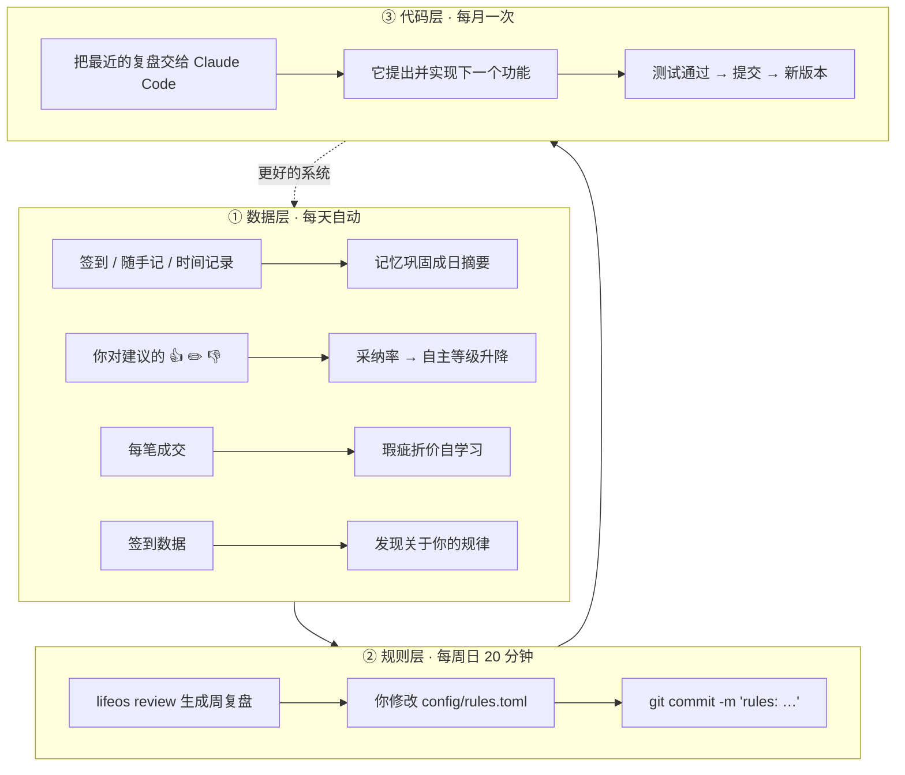

# 🔁 迭代机制：这个系统如何越用越懂你

> 任何迭代都先过三个问题（来自[主体性-设计反思](主体性-设计反思.md)）：它是帮他**记住**，还是在**要求**他？它让他更**在场**，还是更**焦虑**？他今天什么都不想做时，这个功能会不会让他愧疚？

> 系统的重点不是第一版有多完美，而是**每一周都比上一周更懂你一点**。
> 迭代发生在三个层面：**数据层（自动）→ 规则层（每周你来改）→ 代码层（每月让 Claude Code 来改）**。

## 一、三层迭代

### ① 数据层（已实现，自动运行）

| 机制 | 代码位置 | 它学到什么 |
|---|---|---|
| 记忆检索"复活" | `memory.search` | 常被想起的记忆权重更高 |
| 日摘要巩固 | `memory.consolidate`（签到后自动执行） | 把琐碎记忆压缩成要点 |
| 共现关系增强 | `memory.capture` → `db.relate` | 经常一起出现的事物，星图上连线变粗 |
| 自主等级升降 | `decisions.promotion_candidates / feedback(severe)` | 连续 20 次采纳率 ≥ 90% 提议升级；一次"错得离谱"立即降级 |
| 瑕疵折价校准 | `business.calibrate_defects`（每次售出自动执行） | 你的"雾""划痕"真实值多少钱 |
| 个人规律 | `review.patterns` | 睡眠→能量、锻炼→次日心情、和她相处→心情、一周能量节律 |
| 判断校准 | `decisions.calibration` | 你说 70% 把握的事，实际命中多少 |

### ② 规则层（每周日复盘时）

1. 先读 `python -m lifeos letter` 的信；想看数据再 `python -m lifeos review` → 生成周复盘（存到 `data/reviews/`），有 API key 时附 AI 教练点评
2. 看三样东西：**时间账本**（哪条线超预算）、**洞察**（系统发现的规律和冲突）、**你的否决理由**（系统哪里不懂你）
3. 打开 `config/rules.toml` 改规则：调时间块、调预算、调主线/支线、调捡漏门槛……
4. `git commit -m "rules: 周三晚上不排上架，挪到周四"` —— **规则的修改历史就是你生活方式的进化史**

### ③ 代码层（每月一次）

在这个仓库里打开 Claude Code，说：

> 读 `data/reviews/` 里最近 4 周的复盘、`data/我的说明书.md` 和 `docs/迭代机制.md` 的待办清单，告诉我系统最该改进的一件事，然后实现它、写测试、提交。

每个版本都记录在 `CHANGELOG.md`。

## 二、季度节点（每季度第一个周日，2 小时）

- 更新人生导则 `principles/人生导则.md`（修订记录用 git 保存）
- 重新选主线/支线/冻结线（`rules.toml` 里每个领域的 `role`）
- 系统体检：哪些功能三个月没用过？**删掉**。系统不能成为第 15 条需要维护的线。

## 三、版本路线图（待办清单）

按"先有用，再好看，最后聪明"的顺序。每完成一项，从这里删掉并写进 CHANGELOG。

### v0.2 — 降低输入摩擦（下一步）
- [ ] 签到对话由 Claude 动态生成问题（根据当天日程和待确认事项）
- [ ] 《我的说明书》+ 人生导则作为"核心记忆块"注入所有 AI 调用（借鉴 Letta）
- [ ] Part 3 卡片算法换成 FSRS；从工作记忆自动生成 PEDR 经验记录草稿
- [ ] 家务区域轮值 + 消耗品库存（快递包材、清洁用品）提醒（借鉴 Grocy）
- [ ] 未完成任务自动顺延；全命令支持 `--json`（借鉴 lifeos-cli）
- [ ] 上架文案由 Claude 根据照片生成（多模态）

### v0.3 — 更深的记忆
- [ ] 记忆冲突检测与更新（借鉴 Mem0 的 ADD/UPDATE/DELETE）
- [ ] 关系边加时间有效期（借鉴 Graphiti 的时序图谱）
- [ ] 语义向量检索（记忆超过几千条时）
- [ ] 周/月/季度摘要逐级巩固

### v0.4 — 自动采集与协作
- [ ] 数据连接器：日历、Apple Health 睡眠步数、Kindle 高亮（借鉴 HPI）
- [ ] 捡漏雷达：接入平台官方 API / 保存搜索，自动套用 `deal` 模型只推送值得看的
- [ ] 多人模式：她也能登录，共同管理器材平台和冰岛计划

### v0.5 — 预测
- [ ] 预测下周能量与关系时间被挤压的风险
- [ ] 季度"人生投资组合"分析
- [ ] 年度叙事：自动生成年度回顾（照片 + 数据 + 故事）

## 四、系统自评指标（每季度看一次）

| 指标 | 健康标准 | 现在怎么看 |
|---|---|---|
| 每天输入耗时 | < 10 分钟 | 自我感受 |
| 建议采纳率 | > 75% | `lifeos autonomy` |
| 被自动化的决策类型数 | 持续增加 | `lifeos autonomy`（L2 以上的数量） |
| 记忆准确率 | > 95% | `lifeos confirm` 里需要纠正的比例 |
| 和她的高质量时间 | 不低于底线 | 周复盘 |
| 主观价值："它让我生活更好了吗？" | ≥ 7/10 | 季度自问 |
